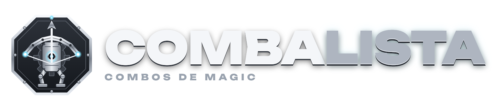
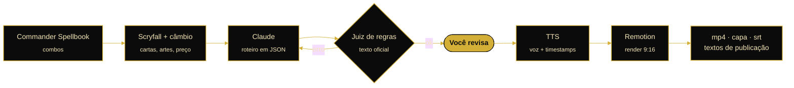
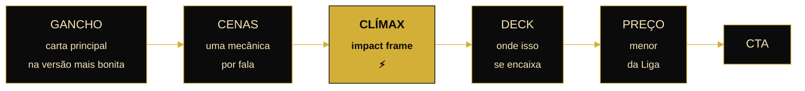
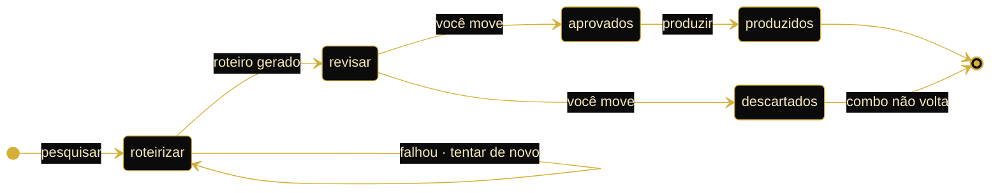

<div align="center">



### Interações absurdas de Magic, explicadas em 60 segundos.

Uma pipeline que pesquisa, roteiriza, narra e anima shorts verticais de Commander,<br>
com um humano aprovando cada roteiro antes do render.


</div>

---

## A ideia em uma frase

> Carta nova encontrando carta velha, joia esquecida na pool, jogada que ninguém espera.
> **Combo barato é só uma das pautas, não o canal.**

O nome é combo + lista, em homenagem à Walking Ballista.

---

## Da base de dados ao vídeo



A única etapa dourada é a sua. Todo o resto roda sozinho, mas nada vai para o render sem passar por ela (a não ser que você escolha o modo `pipeline`).

---

## Quatro pautas

| Pauta | Pergunta que responde | Controle |
|---|---|---|
| `novidade` | O que a coleção nova quebra junto com cartas antigas? | `NOVIDADE_MESES` |
| `joia` | Que carta quase ninguém joga e merecia jogar? | `JOIA_RANK_EDHREC` |
| `inusitado` | Que interação estranha funciona de verdade? | ideias do Claude + checagem |
| `barato` | Quanto custa montar isso? | `MAX_TOTAL_BRL` |

`PAUTAS` mistura as quatro; no painel dá para fixar uma. Ideias da pauta `inusitado` vêm marcadas como **“Checada pelo Claude”**: foram verificadas contra o Spellbook ou contra o texto oficial, mas merecem leitura atenta.

---

## Anatomia de um short



Cada cena do roteiro carrega **uma ação de mecânica**, e é ela que o tabuleiro anima:

`apresentar` · `conjurar` · `virar 90°` · `mana` · `fichas` · `comprar` · `dano` · `atacar` · `sacrificar` · `exilar` · `copiar` · `marcadores` · `loop` · `vitória`

---

## Decisões de direção

O que separa este projeto de um gerador de slides com narração.

| Decisão | Por quê |
|---|---|
| **Tabuleiro contínuo** em vez de slides | Combo é mudança de estado. As cartas ficam na mesa e cada ação altera o que já está lá (`boardState.ts`), então o espectador acompanha o jogo, não uma sequência de imagens. |
| **Um juiz depois do roteirista** | LLM confunde atacar com causar dano, ignora a pilha, esquece o que está virado. Um segundo passe confere tudo contra o texto oficial das cartas e fichas e devolve o roteiro se achar erro. |
| **O fundo começa cinza e ganha cor** | A cor nasce quando o combo “liga”. A cor de destaque vem da carta principal, a segunda cor da guilda vira a luz de fundo. Cada vídeo tem paleta própria dentro da mesma identidade. |
| **Versão premium só na apresentação** | A carta principal entra como Secret Lair, foil, etched ou borderless, com o acabamento simulado no render, e volta à impressão normal para a explicação. Vitrine primeiro, leitura depois. |
| **Movimento de marionete** | Antecipação, inclinação na direção do movimento e motion blur. Cartas têm peso. |
| **Drama com orçamento** | Impact frame P&B, speed lines e corte diagonal só nas falas marcadas com ⚡ e no clímax. Se tudo é épico, nada é. |
| **Humor com regra** | Sério mas leve, hipérbole e humor ácido com moderação. Frases batidas reprovam na validação; no máximo 2 memes sonoros por vídeo, sempre como ponto final de piada. |
| **Preço da Liga, digitado por você** | O Scryfall dá uma estimativa em dólar. O fechamento só perde o “aprox.” quando você informa o menor preço da LigaMagic. |

### Identidade Black & Gold

| Camada | Elemento |
|---|---|
| Fundo | preto com poeira dourada e luz quente no canto |
| Tipografia | Cinzel dourado |
| Viradas de ato | faíscas e rasgo de luz |
| Textura | grão de filme, light leak, raios volumétricos |
| Partículas | núcleo quente com rastro |

Tudo vive em [`src/theme.ts`](src/theme.ts): cores, fontes, zonas seguras e molas.

---

## O fluxo de aprovação



| Pasta | Estado |
|---|---|
| `fila/0-roteirizar/` | combo pesquisado, roteiro falhou ou pendente |
| `fila/1-revisar/` | roteiro pronto, esperando você |
| `fila/2-aprovados/` | liberado para narração e render |
| `fila/3-produzidos/` | feito; o vídeo está em `output/` |
| `fila/descartados/` | nunca mais é pesquisado |

Combos em qualquer pasta da fila ou em `data/history.json` não voltam na pesquisa.

---

## Começar

```powershell
cd mtg-shorts
npm install
copy .env.example .env      # preencha HANDLE e, se quiser, as chaves
npm run studio              # ajuste o visual com dados fictícios
```

Depois, dois cliques em **`Abrir Painel.cmd`** (ou `npm run painel`) → `http://localhost:5178`.

> Requisitos: Node 20+ e cerca de 2 GB livres. Na primeira execução o Remotion baixa o Chrome headless que usa para renderizar.

### Sem chave nenhuma, funciona

| Peça | Com chave | Sem chave |
|---|---|---|
| Roteiro | `ANTHROPIC_API_KEY` | Claude Code instalado na máquina, usando seu plano |
| Voz | Cartesia (plano grátis) ou ElevenLabs | `windows` (Maria, offline) ou `mudo` (só legenda) |

---

## O painel

```
┌─ CombaLista ───────────────── voz [Garota ▾]  pauta [inusitado ▾]  🎲 RAMPAGE ×5 ─┐
│                                                                                   │
│  Roteirizar │ Revisar │ Aprovados │ Produzidos │ Descartados                      │
│ ──────────────────────────────────────────────────────────────────────────────── │
│  combo  ▸  Roteiro │ Cartas │ Fatos & regras │ Publicação │ Vídeo                 │
│                                                                                   │
│  falas · ação de cada cena · ⚡ drama · meme · cameo      [ log em tempo real ]   │
└───────────────────────────────────────────────────────────────────────────────────┘
```

- **RAMPAGE ×5** pesquisa, escreve, aprova e renderiza cinco vídeos sem parar.
- Cartas, preços e os passos originais do Spellbook lado a lado com o roteiro.
- Editor com contagem de palavras, duração estimada e a mesma validação da pipeline. `Ctrl+S` salva.
- Painel e linha de comando mexem nas mesmas pastas; dá para misturar.

| Comando | O que faz |
|---|---|
| `npm run pesquisar` | busca combos e escreve roteiros em `fila/1-revisar/` |
| `npm run produzir` | narra e renderiza só o que está em `fila/2-aprovados/` |
| `npm run pipeline` | tudo de uma vez, sem revisão humana |
| `npm run studio` | Remotion Studio para trabalhar o visual |
| `npm run sfx` | gera os efeitos sonoros padrão |
| `npm run logo` | regera logo e ícone (`--ativar` coloca em uso) |

**Agendar** a pesquisa diária:

```powershell
powershell -ExecutionPolicy Bypass -File scripts/agendar-windows.ps1 -Hora "09:00"
# -Modo pipeline quando confiar no conteúdo
```

---

## O que sai de cada execução

```
output/2026-10-22/
├── relatorio.md              o que deu certo, o que falhou
└── rhystic-study-…/
    ├── video_9x16.mp4
    ├── capa.jpg              frame do gancho, para thumbnail
    ├── publicacao.md         título, descrição e hashtags por plataforma
    ├── legendas.srt          legenda fechada
    └── roteiro.json · props.json   para re-renderizar
```

---

## Som

| Camada | Origem | Ajuste |
|---|---|---|
| **Voz** | `TTS_PROVIDER`: `cartesia` (padrão) · `windows` · `elevenlabs` · `mudo` | vozes prontas em `data/vozes.json`, `TTS_VOZ`, `TTS_VELOCIDADE`; silêncio das pontas é cortado |
| **Pronúncia** | `data/pronuncia.json` | “land” → “lendi”, “grave” → “greive”; a legenda mantém o termo original |
| **Efeitos** | `public/sfx/padrao/` | whoosh, impacto, soco, caixa registradora. Para trocar: `public/sfx/meus/<mesmo-nome>.mp3` |
| **Memes** | 50 sons do Meme SFX Pack (SampleFocus) em `public/sfx/memes/` | fixos: bonk no dano de combate, bruh no bloqueio, “that’s a lot of damage” no dano infinito |

> A licença dos memes permite uso em vídeo monetizado sem crédito, mas **não permite redistribuir os arquivos soltos**. Mantenha `public/sfx/memes/` fora do repositório público.

---

## Marca

`CANAL_NOME=CombaLista` no `.env`. Ícone no canto do vídeo, logo no fechamento (`public/brand/`).
Para trocar, clique no logo do painel → **Trocar PNG**. **Restaurar padrão** volta ao original em `public/brand/padrao/`. O desenho base está em `scripts/logo/logo.html`.

---

## Mapa do código

```
src/                      o que se vê
├── theme.ts              identidade inteira · comece aqui
├── Short.tsx             composição: fundo, cenas, áudio, legenda karaokê, rasgos de luz
├── Board.tsx             tabuleiro e a animação de cada mecânica
├── boardState.ts         o que cada ação muda na mesa
├── scenes.tsx            abertura, clímax, deck, preço, CTA
└── card.tsx · fx.tsx     carta (verso, virar, queimar) e efeitos

pipeline/                 o que se decide
├── research.ts           pautas: Spellbook + Scryfall + câmbio
├── discover.ts           pauta inusitado: ideias + checagem
├── script.ts             roteiro + validação + juiz
├── llm.ts                Claude via API ou Claude Code
├── tts.ts                voz com timestamps
├── build.ts · render.ts  monta o job, baixa assets, renderiza
├── queue.ts · run.ts     fila e orquestrador
├── roteiro.ts            ponte do /roteirizar
└── server.ts             servidor do painel

painel/index.html         interface
.claude/skills/roteirizar o comando /roteirizar do Claude Code
```

<details>
<summary><b>Todas as variáveis do <code>.env</code></b></summary>

| Variável | Função |
|---|---|
| `HANDLE` | @ do canal |
| `CANAL_NOME` | nome exibido no vídeo |
| `ANTHROPIC_API_KEY` | opcional; sem ela, usa o Claude Code |
| `TTS_PROVIDER` | `cartesia` · `windows` · `elevenlabs` · `mudo` |
| `TTS_VOZ` · `TTS_VELOCIDADE` | voz padrão e velocidade |
| `TTS_WINDOWS_RATE` | velocidade da voz do Windows, de -10 a 10 |
| `ELEVENLABS_API_KEY` · `ELEVENLABS_VOICE_ID` | opcionais |
| `PAUTAS` | mistura de `novidade`, `inusitado`, `joia`, `barato` |
| `NOVIDADE_MESES` | o que conta como carta nova |
| `JOIA_RANK_EDHREC` | o que conta como carta pouco jogada |
| `PRECO_TETO_BRL` | teto de preço fora da pauta barato |
| `MAX_TOTAL_BRL` | teto de custo na pauta barato |
| `MAX_CARDS` | máximo de cartas no combo (2–3 rende melhor) |
| `ONLY_SELF_CONTAINED` | `1` = só combos sem peças genéricas |
| `CSB_QUERY` | busca do Commander Spellbook, mesma sintaxe do site |
| `VIDEOS_PER_RUN` | vídeos por execução |
| `PRICE_MULTIPLIER` | ajuste da estimativa para o mercado BR |

Preço manual por carta: `data/price-overrides.json` (prioridade sobre a estimativa).

</details>

---

## Limites conhecidos

- **Preço é estimativa** até você informar o valor da LigaMagic. A base é o menor preço em papel do Scryfall (USD, TCGplayer) convertido pelo câmbio do dia.
- **O juiz reduz erro, não zera.** Revise os primeiros vídeos antes de ligar o modo `pipeline`.
- **Nomes em inglês.** Tradução via Scryfall (`lang:pt`) é possível e ainda não existe.
- **Direitos.** Imagens de cartas são da Wizards of the Coast. Leia a Fan Content Policy da Wizards e a política do Scryfall (que pede para manter o crédito do artista) antes de monetizar.

## Próximos passos

- [ ] Publicação automática (YouTube Data API; TikTok e Instagram exigem app aprovado)
- [ ] Versão 16:9 do mesmo vídeo
- [ ] Variações de gancho para teste A/B
- [ ] Trilha com ducking sob a narração
